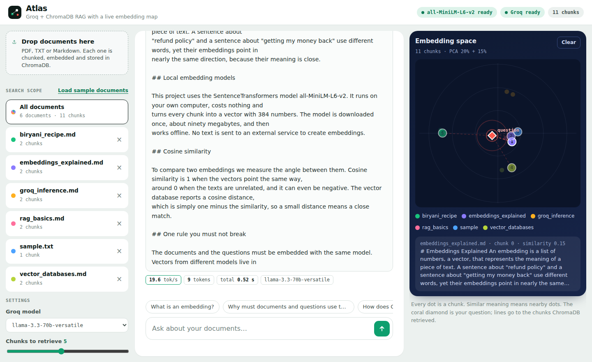
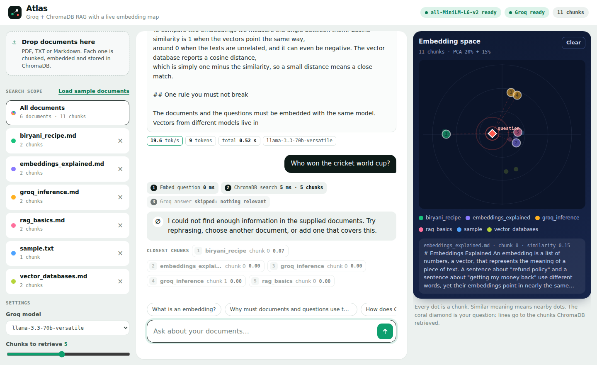

# Atlas: Groq + ChromaDB RAG with a live embedding map

The class project (`groq_chromadb_rag`: CLI + `/rag/query` API) upgraded to a full-stack web app.
Same architecture, now with a real UI:

- **Embeddings:** SentenceTransformers `all-MiniLM-L6-v2`, running locally and free
- **Vector database:** ChromaDB (persistent, cosine distance)
- **LLM:** Groq, used only to write the final answer
- **Backend:** FastAPI (streaming answers over Server-Sent Events)
- **Frontend:** upload documents, ask questions, see sources, and watch retrieval on an **embedding map**



## What is new compared with the class version

| Class version | Atlas |
|---|---|
| `ingest.py` reads a folder | Upload PDF / TXT / Markdown in the browser, delete documents, reset, or still run `ingest.py` |
| Answer printed at the end | Token streaming, time to first token, tokens per second |
| Sources as text in the terminal | Source chips with file, page, chunk and similarity; click to read the chunk |
| No view of the search | **Embedding map**: PCA of all chunks, your question as a coral diamond, lines to the retrieved chunks |
| Always searches everything | Choose a scope: one document or all documents |
| Always calls the LLM | If no chunk is similar enough (`MIN_SIMILARITY`), it says so **without calling Groq** |
| Single question | Follow-up questions are rewritten into standalone queries |
| Errors are raw | Empty question, empty database, bad files, missing key, rate limits and busy servers have clear messages |



## Run it

Python 3.10+ and a free Groq key from <https://console.groq.com>.

```bash
python -m venv venv
venv\Scripts\activate            # Mac/Linux: source venv/bin/activate
pip install -r requirements.txt

copy .env.example .env           # Mac/Linux: cp .env.example .env
# edit .env and set GROQ_API_KEY

uvicorn api:app --reload
```

Open <http://127.0.0.1:8000>. API docs: <http://127.0.0.1:8000/docs>.

**First run:** the embedding model (about 90 MB) downloads once, so the first start takes a minute. The top bar shows
"Loading embedding model…" and then "all-MiniLM-L6-v2 ready". Installing PyTorch is also a large download.

Click **Load sample documents** to index the files in `data/` (RAG, embeddings, vector databases, Groq, and a biryani recipe
that sits far away from the others on the map), or upload your own.

The original commands still work:

```bash
python ingest.py --reset      # index everything in data/
python cli.py                 # ask questions in the terminal
```

## How it works

```
document -> pages -> chunks (1200 chars, 200 overlap)
         -> local embeddings (normalised, 384 numbers each)
         -> ChromaDB (id, vector, text, source/page/chunk metadata)

question -> (rewrite follow-ups) -> embed -> ChromaDB top-k (optional filter: source)
         -> keep chunks with similarity >= MIN_SIMILARITY
         -> numbered excerpts + strict prompt -> Groq streams the answer with [n] citations
```

The map takes every stored vector, centres it and projects it to two dimensions with PCA (SVD). The question vector is
projected with the same basis, so its position is meaningful. Only two dimensions are shown, so nearby dots are not always
the closest in the full 384-dimensional space; the similarity numbers are the real measure.

Documents and questions must be embedded with the same model. If you change `EMBEDDING_MODEL`, run `ingest.py --reset`.

## API

| Method | Path | Purpose |
|---|---|---|
| GET | `/api/health` | Groq key, embedding model status, chunk count |
| GET | `/api/models` | Groq models available to your key |
| GET | `/api/documents` | indexed documents with chunk and page counts |
| POST | `/api/documents` | upload files (field `files`); a re-upload replaces the old version |
| DELETE | `/api/documents/{name}` | remove one document |
| POST | `/api/documents/reset` | empty the database |
| POST | `/api/ingest/folder` | index the `data/` folder |
| GET | `/api/map` | 2-D coordinates of every chunk |
| POST | `/api/rag` | streaming RAG answer (SSE: `stage`, `sources`, `token`, `done`, `error`) |
| POST | `/rag/query` | the original non-streaming endpoint |

```bash
curl -X POST http://127.0.0.1:8000/rag/query -H "Content-Type: application/json" \
     -d '{"question": "What is an embedding?", "top_k": 3}'
```

## Settings (`.env`)

`GROQ_API_KEY`, `GROQ_MODEL`, `EMBEDDING_MODEL`, `CHROMA_PATH`, `TOP_K`, `CHUNK_SIZE`, `CHUNK_OVERLAP`,
`MIN_SIMILARITY` (default 0.18; raise it for stricter answers, lower it if good questions are refused).

## Tests

```bash
pip install -r requirements-dev.txt
pytest -q
```

20 offline tests (a fake embedder and a fake Groq client): chunking, ingestion, replace-on-reupload, retrieval ranking,
source filter, similarity threshold, not-found without an LLM call, stream event order, uploads and validation,
map coordinates, busy-server retry and a missing key. Real embeddings and real Groq answers need the first-run model
download and your API key.

## Layout

```
api.py             uvicorn entry point (same as the class project)
cli.py, ingest.py  terminal tools
app/               config, loader, chunker, embeddings, ChromaDB, projection, Groq, RAG, FastAPI
frontend/          index.html, style.css, app.js (served by FastAPI)
data/              sample documents
tests/             pytest suite
docs/              screenshots (demo data)
```
